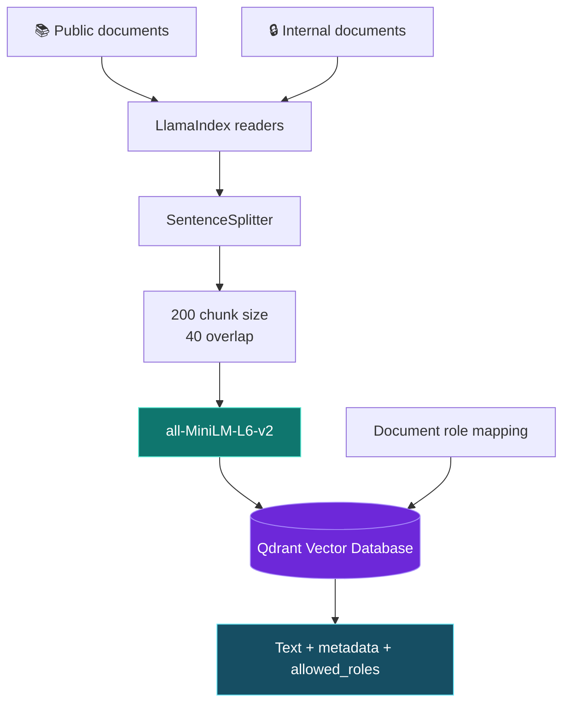
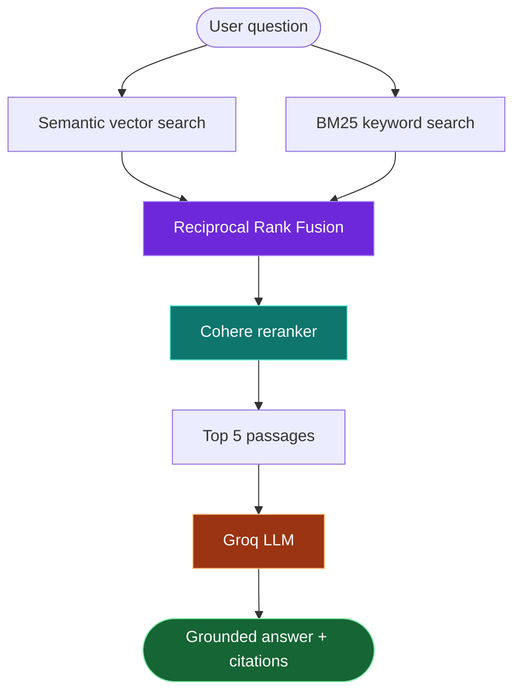
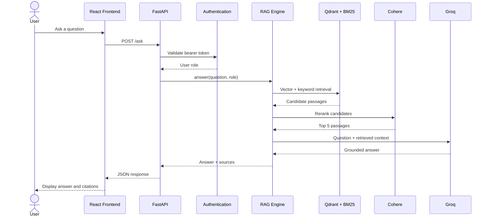
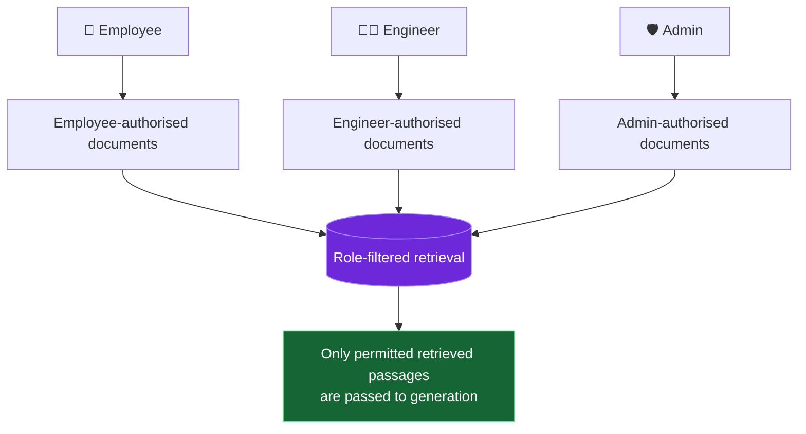
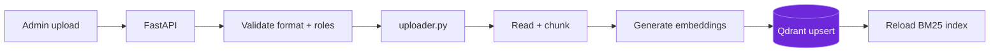

 <div align="center">

# ✦ AMARA TECH
### ENTERPRISE KNOWLEDGE ASSISTANT

**Your organisation's knowledge. One grounded answer away.**

A role-aware Retrieval-Augmented Generation platform that transforms enterprise documents into a conversational knowledge base.


**HYBRID SEARCH · RERANKING · CITATIONS · ROLE-BASED ACCESS**

</div>

---


## ✨ Meet Amara Tech

Imagine asking your company's knowledge base a question instead of searching through hundreds of documents.

Amara Tech makes that possible.

It combines semantic retrieval, keyword search, Reciprocal Rank Fusion, Cohere reranking and LLM-based generation to produce answers grounded in retrieved document passages.

**The principle is simple:**

> Retrieve the evidence. Respect access permissions. Answer from the evidence. Admit when the answer isn't available.

### What makes it useful?

| <div align="center">🔎</div> | <div align="center">🧠</div> | <div align="center">🔐</div> |
|---|---|---|
| **Hybrid retrieval** | **Grounded generation** | **Role-aware access** |
| Combines semantic and keyword search | Answers using retrieved context and numbered citations | Filters retrieved content according to user roles |
| | | |
| <div align="center">📄</div> | <div align="center">⚡</div> | <div align="center">📊</div> |
| **Document uploads** | **Reranking** | **Evaluation & tracing** |
| Admin uploads TXT, PDF and DOCX | Cohere reranks candidate passages | RAGAS evaluation and LangSmith tracing |

---

## 🖥️ The application

The frontend is a React-based conversational interface with three user experiences.

| Employee | Engineer | Administrator |
|---|---|---|
| Ask everyday workplace questions | Access engineering and security knowledge | Ask questions and upload documents |
| View permitted source references | View permitted source references | Assign document access roles |

## Application Screenshots

### Screenshot 1 – RAG Application
.png)

### Screenshot 2 – RAG Application Output
.png)


| Login experience | Chat interface | Admin upload |
|---|---|---|
| `docs/images/login.png` | `docs/images/chat.png` | `docs/images/admin-upload.png` |

---

# 🏗️ UNDER THE HOOD

## 01. The ingestion pipeline

Documents become searchable knowledge through a sequence of loading, chunking, embedding and indexing.



**Embedding model:** `all-MiniLM-L6-v2`  
**Vector dimensions:** 384  
**Vector database:** Qdrant  
**Collection:** `docs`

## 02. The retrieval engine

This is the core of the application.

Instead of depending on only one search method, the system combines two complementary retrieval strategies.



| Stage | Technology | Responsibility |
|---|---|---|
| Semantic search | Qdrant | Finds semantically relevant passages |
| Keyword search | BM25 | Finds keyword-relevant passages |
| Rank fusion | RRF | Combines both rankings |
| Reranking | Cohere | Reorders candidates by relevance |
| Context selection | Top 5 | Selects passages for generation |
| Generation | Groq | Produces the final grounded answer |

**RRF scoring**

\[
RRF(d)=\sum_{r \in rankings}\frac{1}{k+rank_r(d)+1}
\]

## 03. From question to answer

The complete question-answering workflow:



The model is instructed to answer only from the supplied passages.

If the context doesn't contain the answer, the configured fallback is:

**"I don't know based on the available documents."**

## 04. Role-based access control

Different users have different document permissions.



| Role | Access |
|---|---|
| Employee | Public and employee-authorised documents |
| Engineer | Public and engineer-authorised documents |
| Admin | Public and admin-authorised documents |

The `allowed_roles` metadata is used to filter both vector and keyword retrieval.

## 05. Administrator upload workflow

Administrators can upload additional documents and select which roles can access them.



Supported formats: TXT, PDF and DOCX.

---

## 🧰 Technology stack

| Component | Technology |
|---|---|
| Frontend | React 18, ReactDOM, Babel, CSS |
| Backend | Python, FastAPI, Uvicorn |
| Document processing | LlamaIndex |
| Chunking | SentenceSplitter |
| Embeddings | Sentence Transformers |
| Embedding model | all-MiniLM-L6-v2 |
| Vector database | Qdrant |
| Keyword search | BM25 |
| Rank fusion | Reciprocal Rank Fusion |
| Reranking | Cohere rerank-v5.0-fast |
| LLM | Groq — openai/gpt-oss-20b |
| Evaluation | RAGAS |
| Observability | LangSmith |

---

# 📊 EVALUATION

Evaluation scripts and datasets are maintained in the `eval/` directory.

### Recorded results

<div align="center">

| Metric | Mean score | Samples scored |
|---|:---:|:---:|
| Faithfulness · 45-question run | **0.965** | 43 |
| Faithfulness · 15-question run | **1.000** | 14 |
| Context Relevance · 15-question run | **1.000** | 15 |
| Answer Relevancy · partial run | **0.874** | 2 |

</div>

### Score comparison

```text
Faithfulness       45-question   0.965  ███████████████████░
Faithfulness       15-question   1.000  ████████████████████
Context Relevance  15-question   1.000  ████████████████████
Answer Relevancy   Partial       0.874  █████████████████░░░
```

**Evaluation notes**

- The 45-question faithfulness run produced 43 usable scores.
- The separate 15-question faithfulness run produced 14 usable scores.
- Context relevance produced 15 scores.
- Answer relevancy is partial: only two samples were scored before API rate limits interrupted the run.
- These are separate evaluation runs, not one combined benchmark.
- Results represent the successfully scored samples and should not be interpreted as proof of perfect system-wide accuracy.

## 🔭 Observability with LangSmith

The retrieval and answer functions use LangSmith's `@traceable` decorator.

This supports inspection of execution traces for the `rag-platform` project.

User feedback is recorded in `feedback.jsonl`.

---

# 🚀 GETTING STARTED

## Prerequisites

- Python 3.x
- Qdrant instance
- Groq API key
- Cohere API key
- LangSmith API key for tracing

### 1. Clone the repository

```bash
git clone <YOUR_GITHUB_REPOSITORY_URL>
cd RAG-PLATFORM
```

### 2. Create a virtual environment

**Windows PowerShell**

```powershell
python -m venv venv
.\venv\Scripts\Activate.ps1
```

### 3. Install dependencies

```bash
python -m pip install --upgrade pip
pip install -r requirements.txt
```

### 4. Configure environment variables

Create a `.env` file in the project root:

```env
QDRANT_URL=your_qdrant_url
QDRANT_API_KEY=your_qdrant_api_key

GROQ_API_KEY=your_groq_api_key
COHERE_API_KEY=your_cohere_api_key

LANGCHAIN_TRACING_V2=true
LANGCHAIN_API_KEY=your_langsmith_api_key
LANGCHAIN_PROJECT=rag-platform
```

Never commit real credentials or your `.env` file.

### 5. Build the initial index

```bash
python ingest.py
```

> ⚠️ **Important:** `ingest.py` deletes and recreates the existing Qdrant `docs` collection. Run it only when you intend to rebuild the initial index.

### 6. Start the application

```bash
uvicorn api:app --reload
```

| Service | URL |
|---|---|
| Application | `http://127.0.0.1:8000` |
| API documentation | `http://127.0.0.1:8000/docs` |
| Health check | `http://127.0.0.1:8000/health` |

---

## 🔐 Demo accounts

| Username | Password | Role |
|---|---|---|
| emma | emma123 | Employee |
| ethan | ethan123 | Engineer |
| alice | alice123 | Admin |

These are hardcoded demonstration credentials, not production credentials.

## 🔌 API reference

| Method | Endpoint | Purpose |
|---|---|---|
| GET | `/` | Serves the frontend |
| GET | `/health` | Application health and loaded chunk count |
| POST | `/login` | User authentication |
| POST | `/ask` | Question answering |
| POST | `/feedback` | Store user feedback |
| POST | `/admin/upload` | Admin-only document upload |

Authenticated routes use the bearer token returned by `/login`.

---

## 📁 Project structure

```text
RAG-PLATFORM/
│
├── data/
│   ├── internal/
│   ├── wiki_txt/
│   ├── uploads/
│   ├── squad/
│   └── squad_questions.json
│
├── eval/
│   ├── answers.json
│   ├── eval_set.json
│   ├── results_faithfulness.json
│   ├── results_ragas.json
│   ├── results_ranking.json
│   ├── results_retrieval.json
│   ├── run_answers.py
│   ├── run_ragas.py
│   ├── run_ragas_faithfulness.py
│   └── run_ranking_eval.py
│
├── frontend/
│   └── index.html
│
├── api.py
├── rag.py
├── ingest.py
├── uploader.py
├── create_index.py
├── requirements.txt
├── Learning.md
└── README.md
```

---

## ⚠️ Current limitations

This implementation is a project prototype, not a production-hardened enterprise deployment.

- Demo credentials are hardcoded.
- Authentication tokens and messages are stored in memory.
- Feedback is stored in a local JSONL file.
- BM25 is loaded into application memory.
- The frontend uses React and Babel through CDNs.
- Answer relevancy evaluation is incomplete due to API rate limits.
- Production deployment requires stronger authentication, persistent storage, security controls and deployment configuration.

## 🛣️ Future improvements

- Persistent user authentication and conversation storage.
- Expanded automated testing for retrieval and access control.
- More complete RAG evaluation.
- Production frontend build and deployment pipeline.
- Improved monitoring and operational error handling.

---

<div align="center">

# ✦ AMARA TECH

**Making enterprise knowledge easier to access.**

*Hybrid Retrieval · Grounded Generation · Role-Aware Knowledge*

</div>
